# How to compile and install gVirtualXRay Suite

## Building this repository

This section is the procedure for a clone of this repository, the one that the continuous integration runs: it builds the core library (the folder `gvxr/`) and its tests, with CMake 3.26 or newer and a C++23 compiler. The sections that follow, from "Requirements" to "Test the Python wrapper", are the original text of the library's author, written for the release 1.1.5 from SourceForge (the SimpleGVXR library and the wrappers); they are kept as they were. The failures that a configuration or a build can meet are in [Troubleshooting](#troubleshooting).

1. **Install Git LFS before cloning.** The data of the tests is stored with Git LFS, and the configuration stops without `git-lfs` (see [Troubleshooting](#troubleshooting)).
```bash
    $ git lfs install
    $ git clone https://github.com/emartg/gvirtual-xray.git
    $ cd gvirtual-xray
```
If the repository was cloned before Git LFS was installed, run `git lfs install` and `git lfs pull` in it.
2. **Install a compiler and the system libraries.** On Ubuntu, as the Linux job of the CI does (the last three packages are for the tests that need an OpenGL context, on a machine without a display):
```bash
    $ sudo apt-get install build-essential cmake ninja-build libgl-dev libglu1-mesa-dev libegl-dev \
        libx11-dev libxrandr-dev libxinerama-dev libxcursor-dev libxi-dev \
        xvfb libgl1-mesa-dri mesa-utils
```
On Windows, use MinGW-w64 (GCC) and CMake from [https://cmake.org/download/](https://cmake.org/download/). Put CMake's own folder **before** the `bin` folder of MinGW in the `PATH` (see [Troubleshooting](#troubleshooting)).
3. **Configure.** The top-level project is a superbuild: it downloads and builds the dependencies that are not installed (GLFW, GLEW, Assimp, zlib, LibTIFF, FreeType, GoogleTest, and Boost), and installs them in the install prefix. The core library and its tests are built, SimpleGVXR and the wrappers are not.
    - Linux:
```bash
        $ cmake -S . -B build -G Ninja -DCMAKE_BUILD_TYPE=Release -DCMAKE_INSTALL_PREFIX="$PWD/install" \
            -DCMAKE_C_COMPILER=gcc -DCMAKE_CXX_COMPILER=g++ \
            -DBUILD_TESTING=ON -DBUILD_SIMPLEGVXR=OFF -DBUILD_WRAPPERS=OFF
```
    - Windows (PowerShell, MinGW). The install prefix is written with forward slashes because the build modules pass it on to the projects that they build:
```powershell
        $prefix = "$PWD/install".Replace('\', '/')
        cmake -S . -B build -G "MinGW Makefiles" -DCMAKE_C_COMPILER=gcc -DCMAKE_CXX_COMPILER=g++ `
            -DCMAKE_BUILD_TYPE=Release "-DCMAKE_INSTALL_PREFIX=$prefix" `
            -DBUILD_TESTING=ON -DBUILD_SIMPLEGVXR=OFF -DBUILD_WRAPPERS=OFF -DASSIMP_WARNINGS_AS_ERRORS=OFF
```
The first configuration of a new build folder takes several minutes because the dependencies are built; the next ones do not build them again.
4. **Build.** Adjust `--parallel` to the number of cores:
```bash
    $ cmake --build build --parallel 4
```
5. **Run the tests.** The tests are labelled `cpu` (no OpenGL context needed) and `opengl` (they need one):
```bash
    $ ctest --test-dir build -L cpu --output-on-failure
    $ ctest --test-dir build -L opengl -E "TestOpenGLContext|TestCubeSource" --timeout 900 --output-on-failure
```
The second command needs a GPU with an OpenGL driver. On a Linux machine without a display, run it through a virtual display: `xvfb-run -a -s "-screen 0 1600x1000x24" ctest ...` (see [Troubleshooting](#troubleshooting) for the two tests that are left out).
6. **Use the library in another CMake project.** The folder `gvxr/tests/consumer` is a small project that does it with `add_subdirectory()`, and it is built by the CI with the system packages. The library target is `gVirtualXRay::gVirtualXRay`. Do not enable `USE_GLAD`: its OpenGL loader (glad version 2) clashes with the one of an application that has its own, such as glad version 1.

## Requirements

Make sure you have:

- CMake 3.26 or newer (see [http://www.cmake.org/](http://www.cmake.org/));
- A C++ compiler; and
- A GPU that supports OpenGL (integrated GPUs are fine).

### For GNU/Linux

# Ubuntu

1. You need cmake and a compiler:
```bash
    $ sudo apt-get install build-essential

```

```
2. You need some system libraires:
```bash
    $ sudo apt-get install libx11-dev \
        libxi-dev \
        libxcursor-dev \
        libxinerama-dev \
        libxrandr-dev \
        libxxf86vm-dev 
        libopengl-dev \
        libgsl-dev \
        libglu-dev
```

```
3. For unit testing, SimpleGVXR and wrappers (optional):
```bash
    $ sudo apt-get install libegl-dev swig
```

 


# OpenSUSE


The examples below are for openSUSE Leap but you can adapt them for your own distro.

1. You need cmake and a compiler:
```bash
    $ sudo zypper in cmake-full gcc-c++

```
2. You need some system libraires:
```bash
    $ sudo zypper in libX11-devel \
                     libXi-devel \
                     libXcursor-devel \
                     libXinerama-devel \
                     libXrandr-devel \
                     libXxf86vm-devel \
                     glu-devel
```
3. For unit testing, SimpleGVXR and wrappers (optional):
```bash
    $ sudo zypper in Mesa-libEGL1 Mesa-libEGL-devel libgbm1 libgbm-devel
```
4. For unit wrappers (optional):
```bash
    $ sudo zypper in swig \
        ruby-devel \
        tcl-devel \
        python3 python3-devel \
        java-11-openjdk \
        octave-devel \
        R-core R-base  R-core-devel R-base-devel
```         

### Mac OS X:

1. Install XCode from the Mac App Store.
2. Install the Command Line Tools package via the Terminal application using
```bash
    $ xcode-select --install command.
```
3. Install CMake from [https://cmake.org/download/](https://cmake.org/download/)
4. For Wrappers, you may want to install SWIG and Python 3. I use homebrew for that purpose, see [https://brew.sh/](https://brew.sh/)

### Microsoft Windows

1. Install Visual Studio from [https://visualstudio.microsoft.com/vs/](https://visualstudio.microsoft.com/vs/)
    - **Make sure to select the C++ language**
2. Install CMake from [https://cmake.org/download/](https://cmake.org/download/)
3. You may want to install a git client, e.g. [https://git-scm.com/download/win](https://git-scm.com/download/win)
4. You may want to install a SVN client, e.g. TortoiseSVN from [https://tortoisesvn.net/downloads.html](https://tortoisesvn.net/downloads.html)
5. For Wrappers, you may want to install Python 3 from [https://www.python.org/downloads/](https://www.python.org/downloads/) Make sure to install the development libraries.

## Download the latest version of the source code

- The latest release [(gVirtualXRay-1.1.5-Source.zip)](https://sourceforge.net/projects/gvirtualxray/files/1.1/gVirtualXRay-1.1.5-Source.zip/download) available at [https://sourceforge.net/projects/gvirtualxray/files/1.1/gVirtualXRay-1.1.5-Source.zip/download](https://sourceforge.net/projects/gvirtualxray/files/1.1/gVirtualXRay-1.1.5-Source.zip/download) or
- The latest version from SVN at [https://svn.code.sf.net/p/gvirtualxray/code/trunk](https://svn.code.sf.net/p/gvirtualxray/code/trunk)

## Installation from the source code

### GNU/Linux and Mac OS X

Assuming the system is ready.

1. Open a terminal and choose where the binaries should be installed. **It must be a directory where you can write.** If you can't, make sure you use `sudo make` rather than `make` in Steps 5 and 6.
In the example below, I install it in my home directory in `gvxr-install`.
```bash
    $ export GVXR_INSTALL_DIR=$HOME/gvirtualxray-install
```
2. go in the directory where you want to build the gVirtualXRay, e.g.
```bash
    $ mkdir ~/gvxr
    $ cd ~/gvxr
```
3. Download the latest release:
```bash
    $ wget https://sourceforge.net/projects/gvirtualxray/files/1.1/gVirtualXRay-1.1.5-Source.zip/download
    $ mv download gVirtualXRay-1.1.5-Source.zip
    $ unzip gVirtualXRay-1.1.5-Source.zip
```
4. Create a directory where the binaries will be created and go in this directory.
```bash
    $ mkdir gvxr-bin
    $ cd gvxr-bin
```
5. Configure the project using CMake. Use `cmake`, `ccmake` or `cmake-gui` depending on you preferences. `ccmake` and `cmake-gui` are interactive.
    - `cmake`:
```bash
        $ cmake \
            -DCMAKE_BUILD_TYPE:STRING=Release \
            -DCMAKE_INSTALL_PREFIX:STRING=$GVXR_INSTALL_DIR \
            -DBUILD_TESTING:BOOL=ON \
            -DBUILD_WRAPPER_CSHARP:BOOL=ON \
            -DBUILD_WRAPPER_JAVA:BOOL=ON \
            -DBUILD_WRAPPER_OCTAVE:BOOL=ON \
            -DBUILD_WRAPPER_PERL:BOOL=ON \
            -DBUILD_WRAPPER_PYTHON3:BOOL=ON \
            -DBUILD_WRAPPER_R:BOOL=ON \
            -DBUILD_WRAPPER_RUBY:BOOL=ON \
            -DBUILD_WRAPPER_TCL:BOOL=ON \
            -S .. \
            -B $PWD
```
    - `ccmake`:
```bash
        $ ccmake \
            -DCMAKE_BUILD_TYPE:STRING=Release \
            -DCMAKE_INSTALL_PREFIX:STRING=$GVXR_INSTALL_DIR \
            -S .. \
            -B $PWD
```
    - `cmake-gui`:
```bash
        $ ccmake \
            -DCMAKE_BUILD_TYPE:STRING=Release \
            -DCMAKE_INSTALL_PREFIX:STRING=$GVXR_INSTALL_DIR \
            -S .. \
            -B $PWD
```
6. Compile the project.
```bash
    $ make -j16
```
I used a parallel build with 16 jobs as I got 16 cores in my CPU. Adjust `-j` depending on your computer. Once the project is made, it is also installed.
7. Run the unit tests (optional)
```bash
    $ make test
```
8. Install
```bash
    $ make install
```
or at your own risk as `root` using:
```bash
    $ sudo make install
```
If you built the python wrapper, add its path to `PYTHONPATH`:
```bash
    $ PYTHONPATH=$GVXR_INSTALL_DIR/gvxrWrapper-1.0.5/python3:$PYTHONPATH
```
And to make it permanent:
```bash
    $ echo "" >> $HOME/.bashrc
    $ echo "################################################################################" >> $HOME/.bashrc
    $ echo "# Install gvxrPython3 in PYTHONPATH" >> $HOME/.bashrc
    $ echo export PYTHONPATH=$GVXR_INSTALL_DIR/gvxrWrapper-1.0.5/python3:\$PYTHONPATH >> $HOME/.bashrc
    $ echo "################################################################################" >> $HOME/.bashrc
```

### Summary of all the commands:
```bash
export GVXR_INSTALL_DIR=$HOME/gvirtualxray-install

mkdir ~/gvxr
cd ~/gvxr

wget https://sourceforge.net/projects/gvirtualxray/files/1.1/gVirtualXRay-1.1.5-Source.zip/download
mv download gVirtualXRay-1.1.5-Source.zip
unzip gVirtualXRay-1.1.5-Source.zip

mkdir gvxr-bin
cd gvxr-bin

cmake \
    -DCMAKE_BUILD_TYPE:STRING=Release \
    -DCMAKE_INSTALL_PREFIX:STRING=$GVXR_INSTALL_DIR \
    -DBUILD_TESTING:BOOL=ON \
    -DBUILD_WRAPPER_CSHARP:BOOL=OFF \
    -DBUILD_WRAPPER_JAVA:BOOL=OFF \
    -DBUILD_WRAPPER_OCTAVE:BOOL=OFF \
    -DBUILD_WRAPPER_PERL:BOOL=OFF \
    -DBUILD_WRAPPER_PYTHON3:BOOL=ON \
    -DBUILD_WRAPPER_R:BOOL=OFF \
    -DBUILD_WRAPPER_RUBY:BOOL=OFF \
    -DBUILD_WRAPPER_TCL:BOOL=OFF \
    -S .. \
    -B $PWD

make -j16

make test

make install

export PYTHONPATH=$GVXR_INSTALL_DIR/gvxrWrapper-1.0.5/python3:PYTHONPATH

echo "" >> $HOME/.bashrc
echo "################################################################################" >> $HOME/.bashrc
echo "# Install gvxrPython3 in PYTHONPATH" >> $HOME/.bashrc
echo PYTHONPATH=$GVXR_INSTALL_DIR/gvxrWrapper-1.0.5/python3:\$PYTHONPATH >> $HOME/.bashrc
echo "################################################################################" >> $HOME/.bashrc

```


### For Windows

I recommand to use **64 bits** for all the components, including for **Python 3**.

1. Download and extract gVirtualXRay's code from [https://sourceforge.net/projects/gvirtualxray/files/1.1/gVirtualXRay-1.1.5-Source.zip/download](https://sourceforge.net/projects/gvirtualxray/files/1.1/gVirtualXRay-1.1.5-Source.zip/download).
2. Open CMake's gui.

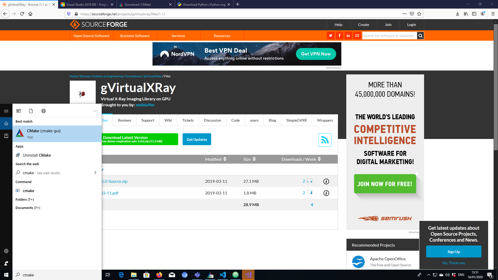

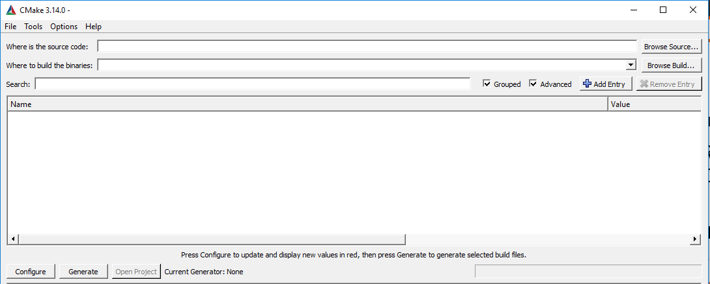

3. Select where the source code is. This is the top directory of the repository that contains CMakeLists.txt.

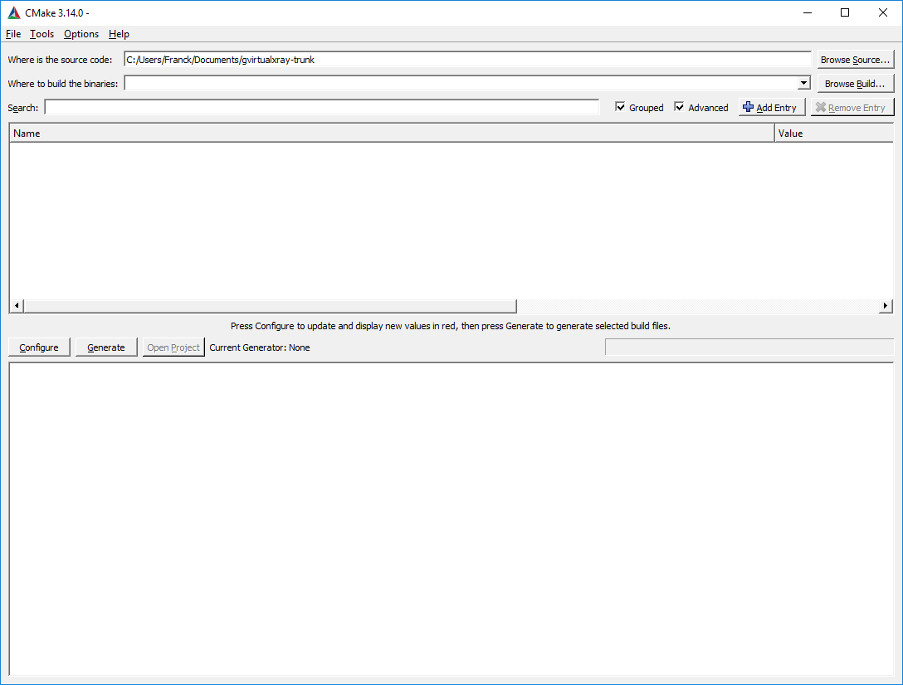

4. Select where the binaries are going to be compiled. It CANNOT be a sub-directory of the source directory chosen in the previous step.

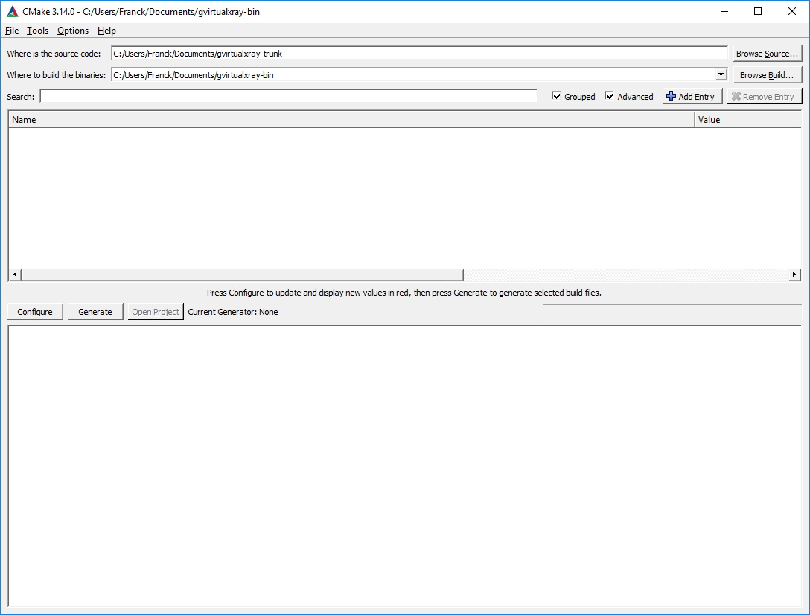

5. Press configure, then choose which compiler you want to use and which architecture. I used Visual Studio 15 2017's native compilers, and x64 (for 64 bits).

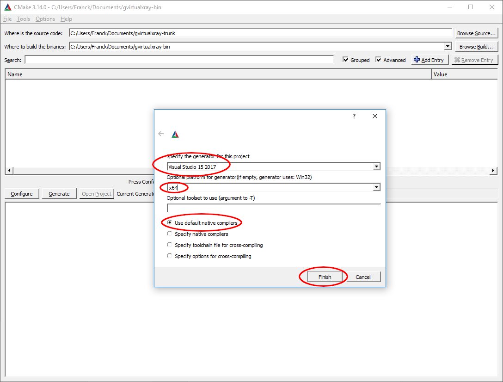

6. Click on `Configure`. There'll be an error, but don't worry about it.

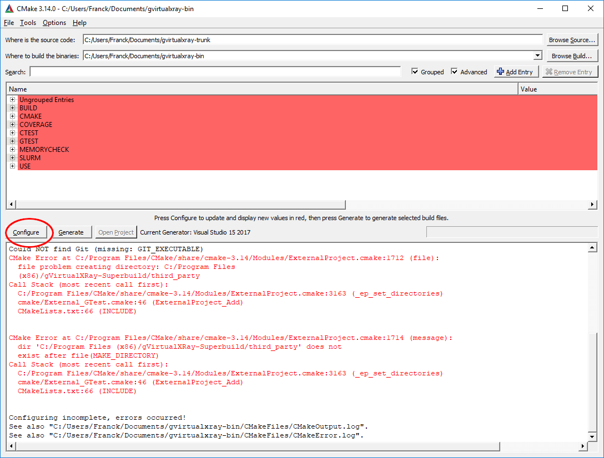

7. Search for `install`.

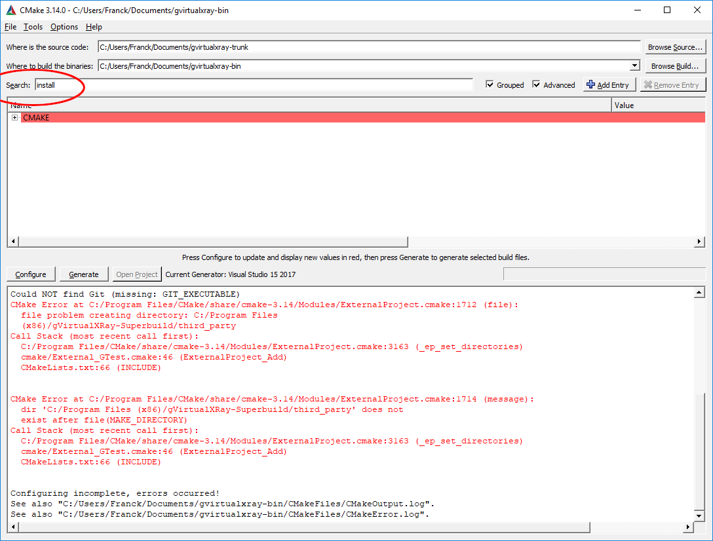

8. Change the variable `CMAKE_INSTALL_PREFIX` into a path where you are allowed to write. Click on configure. If it does not work, change the path and make sure you have write privilege for that path.

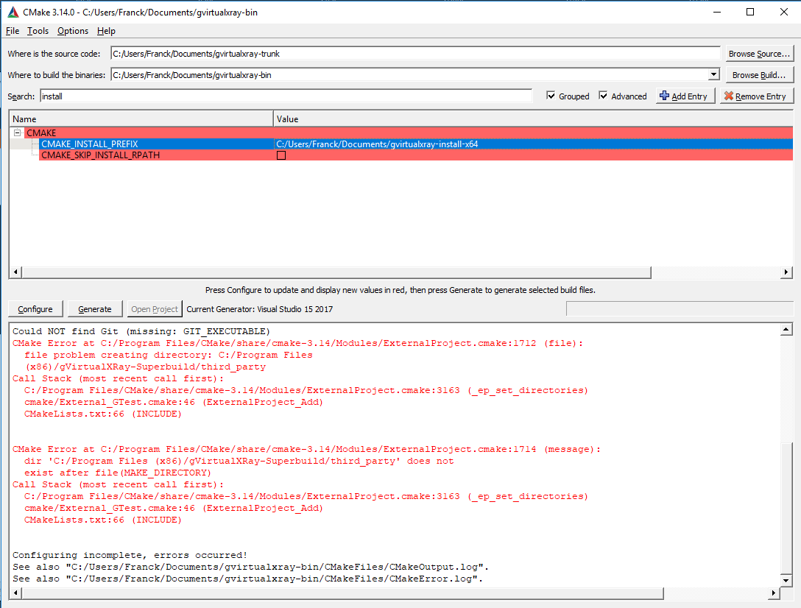

9. If you want to build a wrapper, e.g. for Python 3, go to `BUILD` and tick the right option(s) (in my case `BUILD_PYTHON£_WRAPPER`). Now you can click on `Configure`, then `Generate`, then `Open Project`.

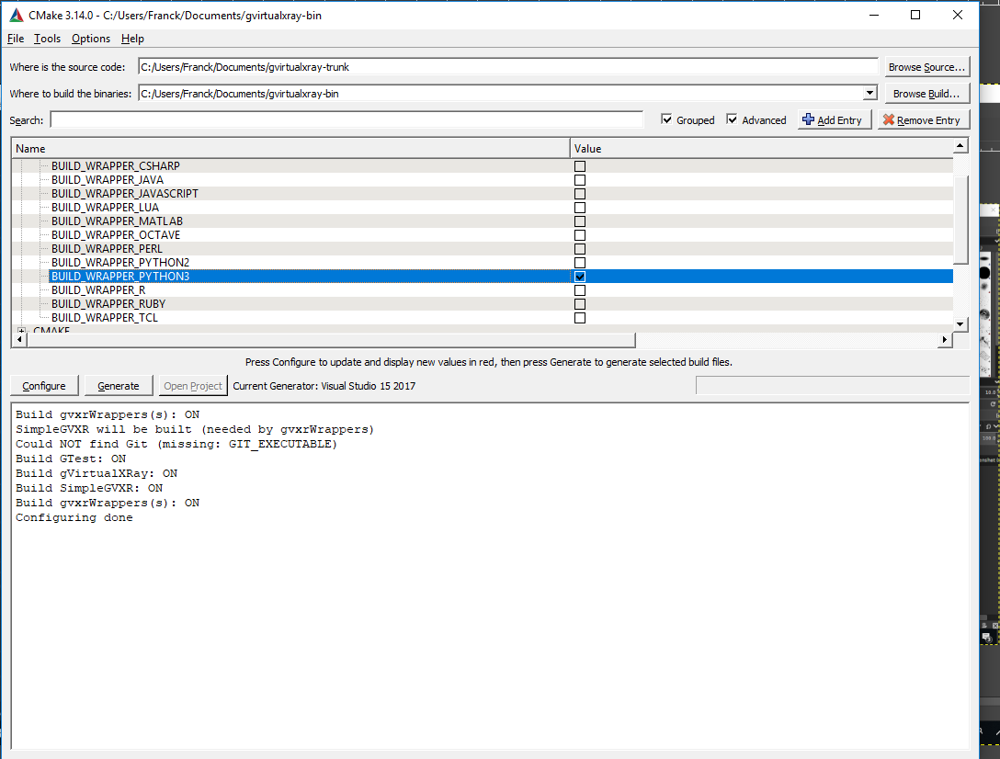

10. It will open Visual Studio. Change Debug into Release.

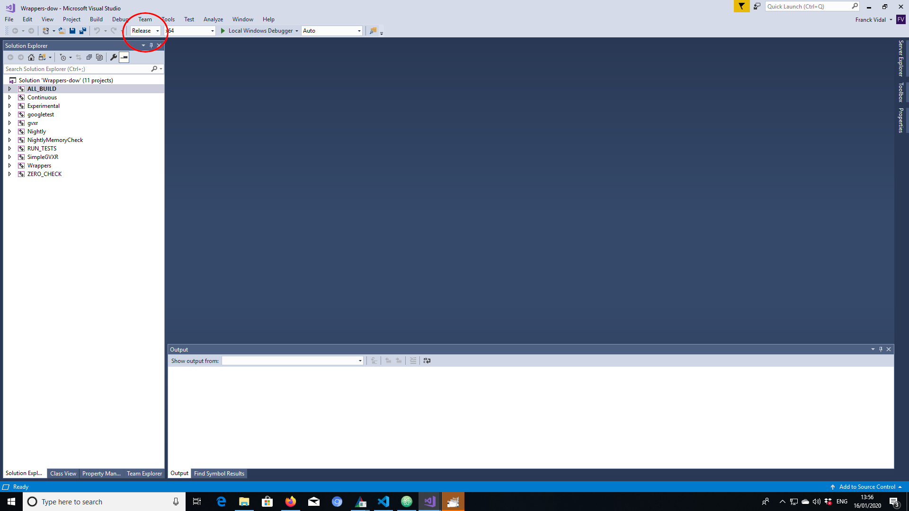

11. Do a right click on `BUILD_ALL` or press the `F7` key to build the project.


12. Go and make some coffee, it's gonna take a bit of time...
At the end, in the output, you should see something like
```
========== Build: 4 succeeded, ...
```


#### Installation directory content in Windows

On Windows, you Should see 4 or 5 directories in the installation directory depending on wrappers:

- bin
- third_party
  - include
  - lib (Windows) or lib64 (GNU/Linux and Mac OS X???)
- gVirtualXRay-1.1.5
  - Bin2C.cmake
  - CreateHeaderFiles.cmake
  - gVirtualXRayConfig.cmake
  - include
  - lib
  - LICENSE.txt
  - test
  - third_party
  - UsegVirtualXRay.cmake
- SimpleGVXR-1.0.4
  - include
  - lib
  - SimpleGVXR-doc.i
  - SimpleGVXRConfig.cmake
  - test
  - UseSimpleGVXR.cmake
- gvxrWrapper-1.0.5
  - data
  - python3

### Installation directory content in GNU/Linux and Mac OS X

On Unixes, you Should see 3 or 4 directories in the installation directory depending on wrappers:

- third_party
  - include
  - lib (Windows and Mac OS X) or lib64 (GNU/Linux)
- gVirtualXRay-1.1.5
  - Bin2C.cmake
  - CreateHeaderFiles.cmake
  - gVirtualXRayConfig.cmake
  - include
  - lib
  - LICENSE.txt
  - test
  - third_party
  - UsegVirtualXRay.cmake
- SimpleGVXR-1.0.4
  - include
  - lib
  - SimpleGVXR-doc.i
  - SimpleGVXRConfig.cmake
  - test
  - UseSimpleGVXR.cmake
- gvxrWrapper-1.0.5
  - data
  - python3

## Test the Python wrapper

1.  Go to `gvxrWrapper-1.0.5/python3`,
2. Execute the test script. You should see something like:

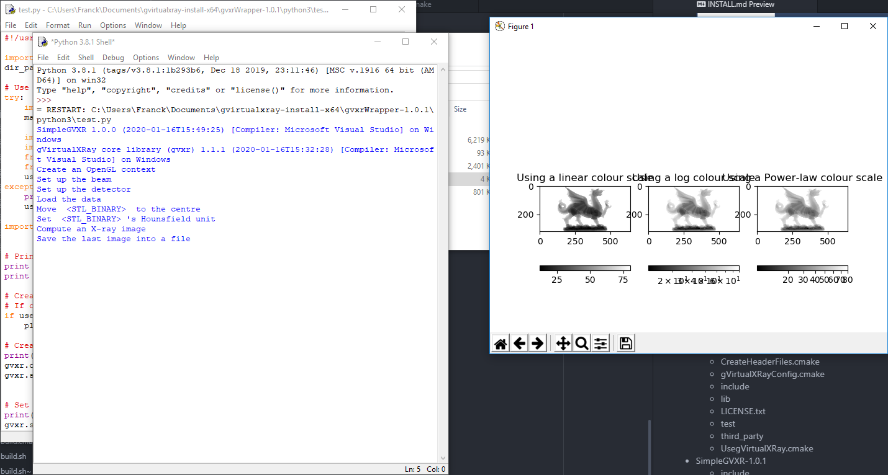
The X-ray image is displayed using linear, log and power law colour scales using Matplotlib.

3. Press `<Q>` to close this window and the real-time viewer will open:

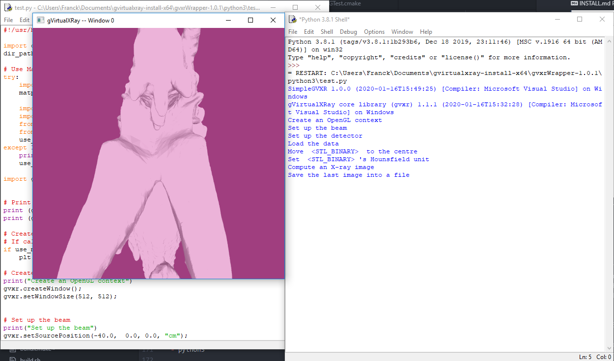

4. Use the mouse wheel to zoom-out:

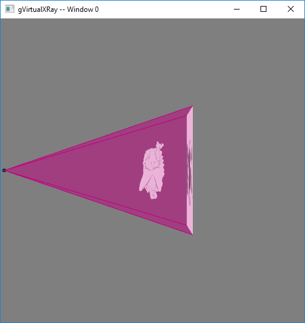

5. Use the mouse left button and move the mouse around to adjust the view:

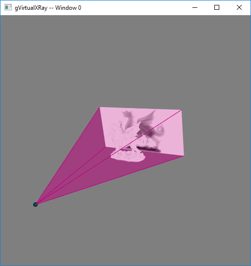

6. Press `<B>` to hide/show the X-ray beam:

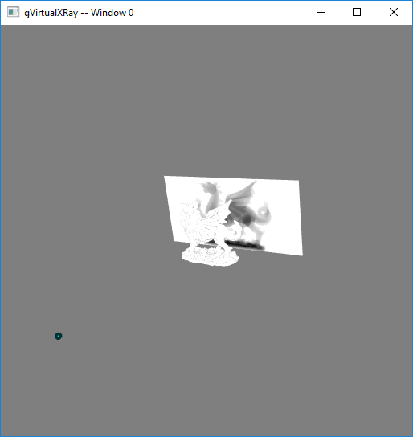

7. Press `<W>` to view the 3-D object in solid/wireframe mode:

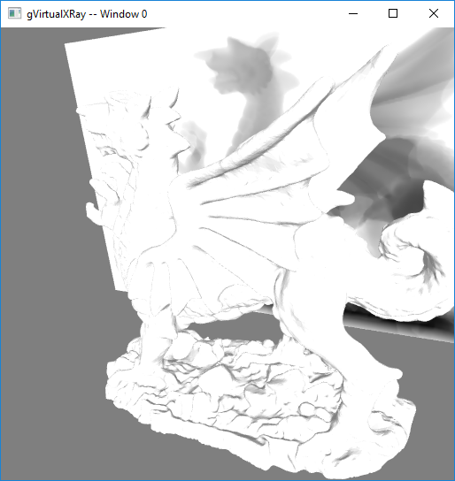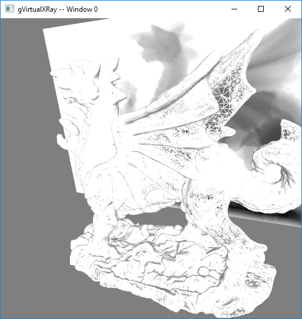

8. You can also press `<N>` to display the X-ray image in negative or positive and `<H>` to hide/show the X-ray detector.
9. Press `<Q>` or `<ESC>` to exit. When the script ends, there'll be two new files:

- `xray_image-0.mha`: contains the X-ray image. MHA fies can be viewed with the popular scientific image viewer tool [ImageJ/Fiji](https://imagej.net/Fiji/).
- `lbuffer-0.mha`: contains the length of X-rays crossed in the 3-D object.
10. If you want to create your own simulations, have a look at the script. You can find it at [https://sourceforge.net/p/gvirtualxray/code/HEAD/tree/trunk/Wrappers/python3/test.py](https://sourceforge.net/p/gvirtualxray/code/HEAD/tree/trunk/Wrappers/python3/test.py).

## Troubleshooting

The failures of a configuration or a build of this repository, with the cause and what to do. The entries that have a title in common with the build instructions of the other repositories of the project keep that title.

### A build folder holds the tools of another compiler

**Symptom.** The configuration stops with `Does not match the generator used previously`, or a build that worked with one compiler fails after switching to another (for example from MinGW to Visual Studio, or from GCC to Clang) with errors that name tools or libraries of the first one.

**Cause.** CMake records the generator, the compilers, and the tools it found in `CMakeCache.txt` of the build folder, and the superbuild also keeps the dependencies that it built with the first compiler in the build folder and in the install prefix. They are not valid for another compiler.

**What to do.** Use one build folder per compiler (for example `build-gcc` and `build-clang`) and delete the build folder, and the install prefix that it filled, before switching a folder to another compiler or generator.

### The download of Boost fails with an SSL certificate error (Windows)

**Symptom.** The configuration stops while it downloads Boost, with a message about the SSL certificate.

**Cause.** The `cmake` found first in the `PATH` is the one that is shipped with a MinGW-w64 installation, which does not find the certificates of the system. The one from [https://cmake.org/download/](https://cmake.org/download/) does.

**What to do.** Put the `bin` folder of that CMake before the `bin` folder of MinGW in the `PATH` of the shell, check with `Get-Command cmake` (PowerShell) that it is the first one, and configure again in a new build folder.

### A download of gzip leaves an empty file (Windows)

**Symptom.** On Windows, when no `gzip` is installed, the build stops at the target `BinaryLibFiles` with `The system cannot find the path specified.`, and nothing in the message names gzip.

**Cause.** The configuration downloads a gzip program when it finds none, extracts it, and records its path in `CMakeCache.txt` without checking that the download worked. The download can leave an empty file, and the recorded path then points to a file that does not exist.

**What to do.** Install a gzip that is in the `PATH` (the one of Git for Windows is in the `usr\bin` folder of its installation), delete `CMakeCache.txt` (or the whole build folder), and configure again. A gzip in the `PATH` is found first and nothing is downloaded.

### The configuration stops with `Git LFS is required`

**Symptom.** The configuration stops with `Git LFS is required. Install it from https://git-lfs.com/`.

**Cause.** `cmake/CheckGitLFS.cmake` looks for the program `git-lfs`. The data of the tests and some assets of the repository are stored with Git LFS.

**What to do.** Install Git LFS (`winget install GitHub.GitLFS` on Windows, `sudo apt install git-lfs` on Debian and Ubuntu, `brew install git-lfs` on macOS), run `git lfs install` once, then `git lfs pull` in the repository, and configure again.

### Tests fail because their data files are not the real files

**Symptom.** Several tests of the `opengl` label fail when they read their input files (the ones of `gvxr/tests/data`), although the library built without errors.

**Cause.** The data files are Git LFS files. A clone made before Git LFS was installed, an archive of the repository (`git archive`, or the zip of a branch downloaded from GitHub), or a clone made with `GIT_LFS_SKIP_SMUDGE=1` holds small text files, the pointers, in their place. A file that starts with `version https://git-lfs.github.com/spec/v1` is a pointer.

**What to do.** Run `git lfs install` and `git lfs pull` in the repository. To fetch only what the tests use, as the CI does: `git lfs pull --include="gvxr/tests/data/**" --exclude="gvxr/tests/data/phantom_sinogram.raw"` (no enabled test reads the phantom sinogram, which is 68 MB).

### `No rule to make target` after updating the repository

**Symptom.** `cmake --build build --target <name>` stops with `No rule to make target '<name>'` (or `unknown target`) just after a `git pull`.

**Cause.** The update added a target, usually a test, and the build folder was generated before it existed. Building does not generate the build files again for a target that the folder does not know.

**What to do.** Configure again before building: `cmake -S . -B build` (the dependencies are not built again), then `cmake --build build --target <name>`.

### The tests that need an OpenGL context fail or never end

**Symptom.** On a machine without a GPU or a display (a server, a container, a continuous integration runner), the tests labelled `opengl` fail at once, or two of them seem to hang.

**Cause.** They need an OpenGL context. On Linux, a virtual display and Mesa's software renderer provide one, but two tests do not work there: `TestOpenGLContext` (its compute shader check reads back 0 where the shader wrote -1000 with the llvmpipe renderer, and it passes on a GPU) and `TestCubeSource` (it takes about 5 minutes with Mesa 26 and exceeded a timeout of 900 seconds).

**What to do.** On a machine with a GPU and its driver, run `ctest --test-dir build -L opengl --output-on-failure`. On a Linux machine without a display, install `xvfb libgl1-mesa-dri mesa-utils` and run `xvfb-run -a -s "-screen 0 1600x1000x24" ctest --test-dir build -L opengl -E "TestOpenGLContext|TestCubeSource" --timeout 900 --output-on-failure`, as the CI does. The tests labelled `cpu` need no context.

### The compilation fails when Vulkan is installed

**Symptom.** The build stops with compilation errors on a machine where the Vulkan loader or a Vulkan SDK is installed, when the library is configured with `-DUSE_GLFW=OFF`.

**Cause.** The configuration defines `HAS_VULKAN` whenever it finds Vulkan, even when GLFW is not used, and the code that this enables does not compile without GLFW. This is a known problem of the library, and it has not been fixed in the repository.

**What to do.** Tell CMake not to look for Vulkan: add `-DCMAKE_DISABLE_FIND_PACKAGE_Vulkan=ON` to the configuration command, in a new build folder.
